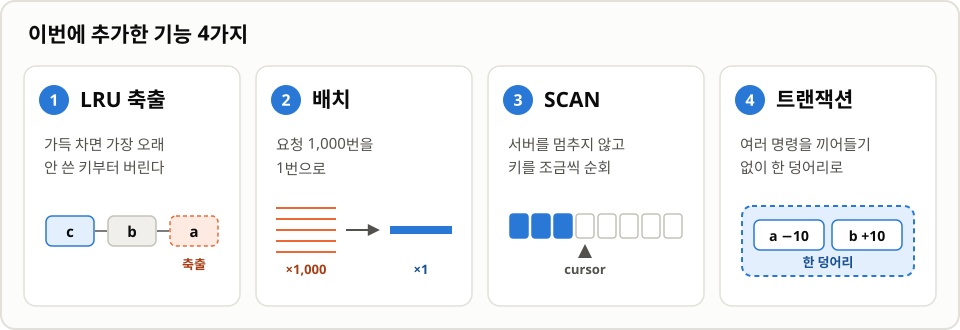
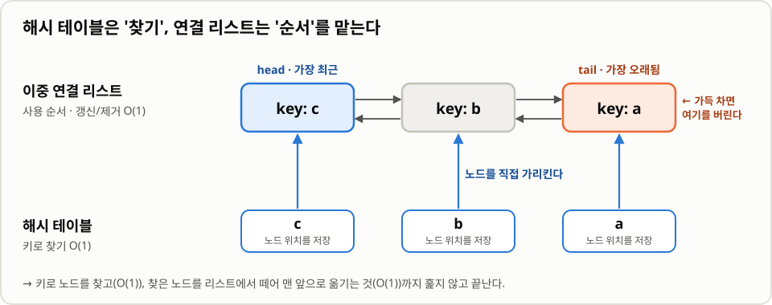
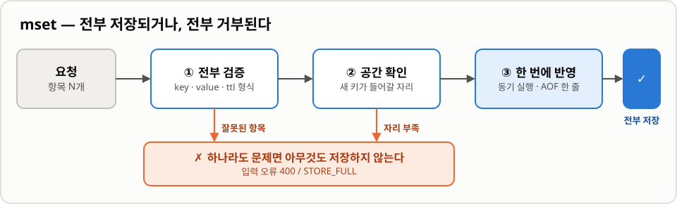
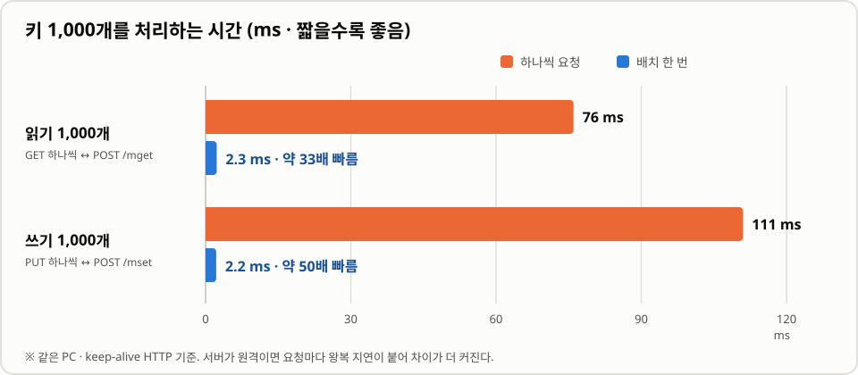
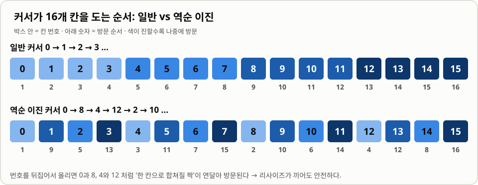
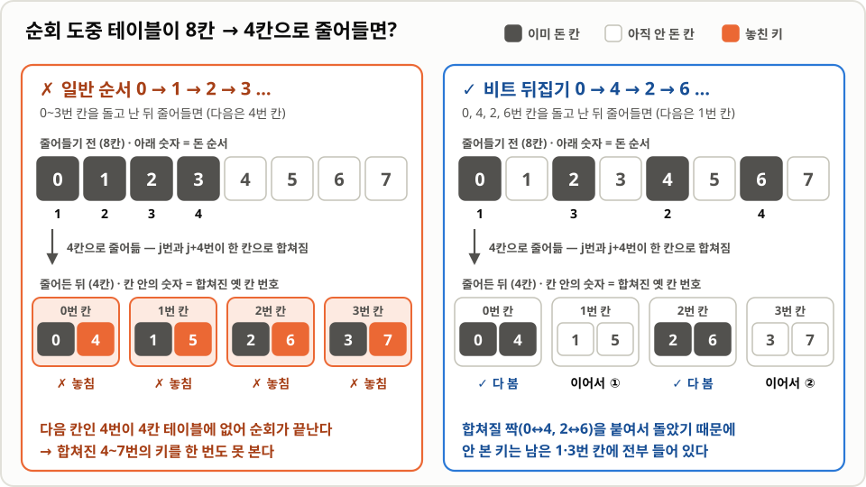
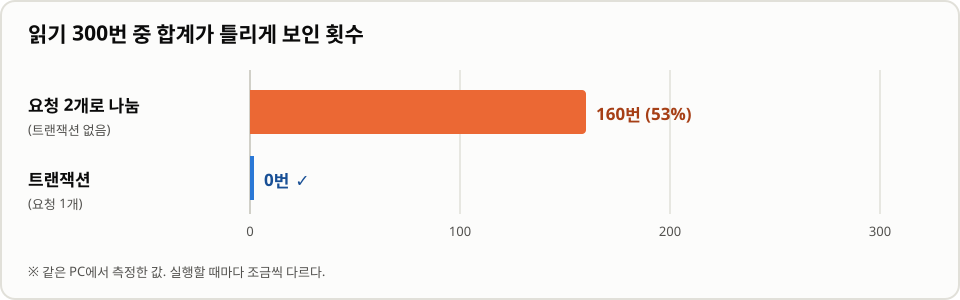
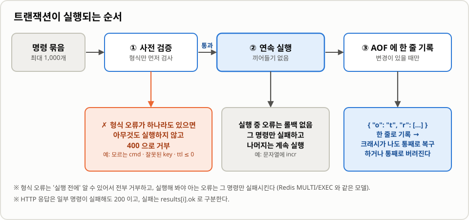
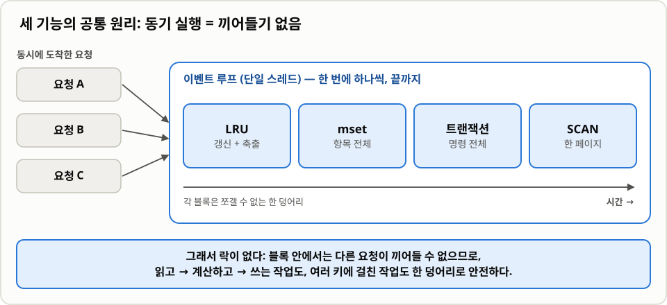

# Mini Redis — 추가 기능 4가지



---

# 1. LRU 축출

**없으면** &nbsp;·&nbsp; 상한이 없다 → 메모리가 계속 늘어 **서버가 죽는다** &nbsp;·&nbsp; 상한만 있다 → 가득 찬 순간부터 **새 키를 전부 거부**한다




**증거** &nbsp;·&nbsp; 무작위 연산 **2만 번**을 `Map` 기반 정답과 비교 → 항상 일치 &nbsp;·&nbsp; `EVICTION=lru MAX_KEYS=1000`

---

# 2. 배치 `mget` / `mset`

**없으면** &nbsp;·&nbsp; 키 N개에 요청 N번 → **고정 비용을 N번** &nbsp;·&nbsp; 따로 읽는 사이 값이 바뀜 → **시점이 섞임** &nbsp;·&nbsp; 쓰다 실패 → **일부만 저장**






한 번에 최대 **1,000개** — 단일 스레드라 크게 하면 그동안 다른 요청이 기다린다

---

# 3. SCAN

**없으면** &nbsp;·&nbsp; `GET /keys` 는 전체를 한 번에 훑는 **O(n)** → 키가 많으면 **서버가 멈춘다** &nbsp;·&nbsp; 커서를 0, 1, 2… 로 올리면 **리사이즈 때 키를 놓친다**





```
GET /scan?cursor=0&count=100   →   { "cursor": 8, "keys": [ … ] }
GET /scan?cursor=8&count=100   →   …          cursor 가 0 으로 돌아오면 끝
```

| 보장 | 비보장 |
|---|---|
| 처음부터 끝까지 있던 키는 **최소 한 번** (리사이즈가 있어도) | 리사이즈가 있었다면 **중복**이 나올 수 있음 |

---

# 4. 트랜잭션

**없으면** &nbsp;·&nbsp; 이체를 요청 2개로 나누면, 그 사이에 다른 요청이 **중간 상태**를 본다






```json
{ "commands": [
    { "cmd": "incr", "key": "acct:a", "by": -10 },
    { "cmd": "incr", "key": "acct:b", "by":  10 }
] }
```

---

# 정리



| 기능 | 없으면 | 해결 | 수치 |
|---|---|---|---|
| **LRU** | 서버가 죽거나 새 키 거부 | 해시 + 이중 연결 리스트 | 무작위 2만 번 정답 일치 |
| **배치** | 요청 N번, 시점 섞임, 부분 저장 | 한 요청 · 동기 실행 · 전부 or 전무 | 76 → 2.3 ms |
| **SCAN** | 서버 정지, 리사이즈 때 누락 | 역순 이진 커서 | 순회 중 확장·축소 OK |
| **트랜잭션** | 중간 상태가 보임 | 끼어들기 없이 연속 실행 | 틀린 합계 160 → 0번 |

> ※ 수치는 같은 PC에서 측정한 값이며 머신마다 다르다.
