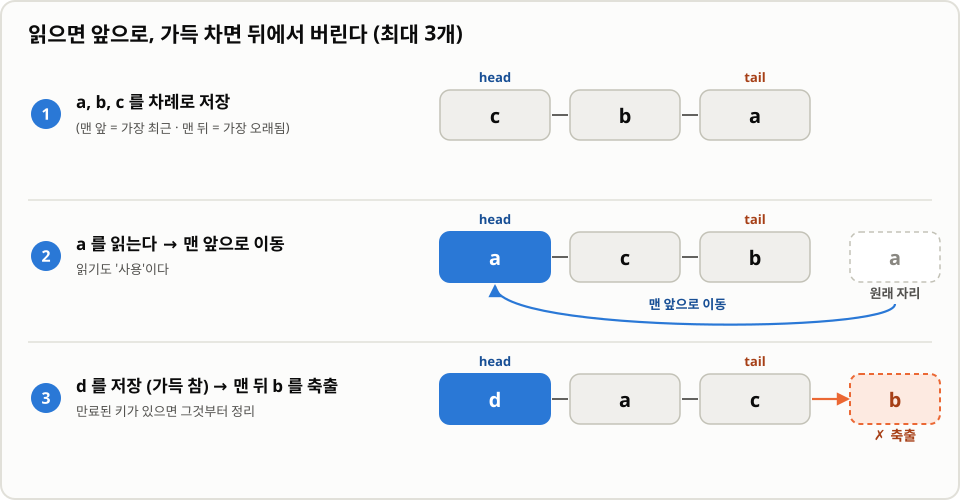
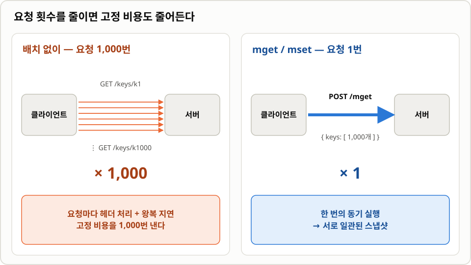
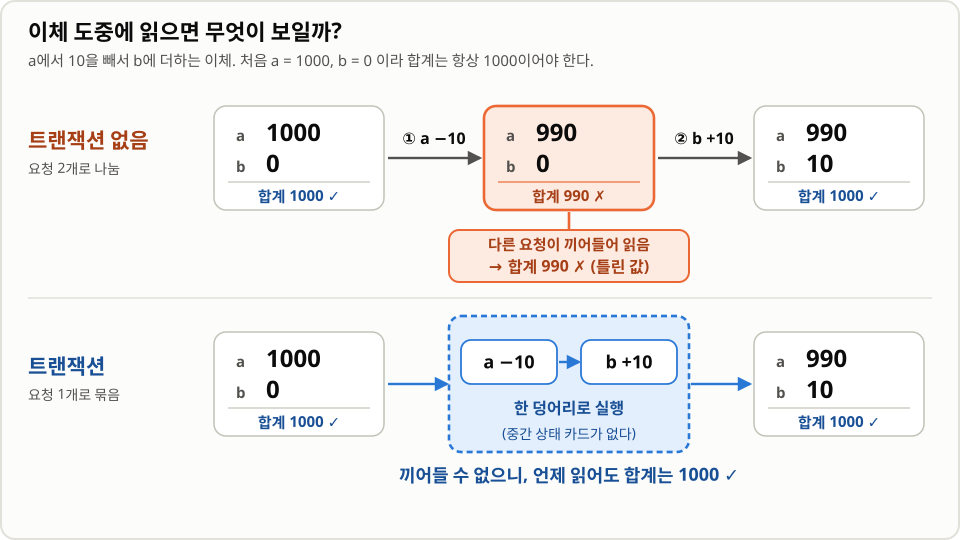

# Mini Redis — 추가 기능 4가지

LRU 축출 · 배치(`mget`/`mset`) · SCAN · 트랜잭션.
각 기능을 **없으면 어떤 문제가 생기는지 → 어떻게 해결했는지 → 증거 → 한계** 순서로 설명합니다.

| 기능 | 한 줄 |
|---|---|
| [1. LRU 축출](#1-lru-축출) | 가득 차면 가장 오래 안 쓴 키부터 버린다 |
| [2. 배치](#2-배치-mget--mset) | 요청 1,000번을 1번으로 |
| [3. SCAN](#3-scan) | 서버를 멈추지 않고 키를 순회한다 |
| [4. 트랜잭션](#4-트랜잭션) | 여러 명령을 끼어들기 없이 실행한다 |

---

## 1. LRU 축출



### 없으면

- **상한이 없으면** 메모리가 계속 늘어 서버가 죽습니다 (OOM).
- **상한만 있으면** (`noeviction`) 가득 찬 순간부터 새 키를 전부 거부(507)하고, 예전에 한 번 쓰고 안 읽는 데이터가 자리를 차지합니다. 적중률이 시간이 갈수록 나빠집니다.

### 해결: 해시 테이블 + 이중 연결 리스트

```
해시 테이블          key ──▶ entry                           찾기 O(1)
이중 연결 리스트     head ⇄ entry ⇄ entry ⇄ tail             순서 갱신 · 제거 O(1)
                    (가장 최근)               (가장 오래됨 = 축출 대상)
```

- 해시 테이블만 있으면 "가장 오래된 것"을 찾으려고 전체를 훑어야 합니다 (O(n)). 리스트만 있으면 키를 찾으려고 훑어야 합니다.
- 해시 테이블이 **리스트 노드를 직접 가리키므로**, 키로 찾은 뒤 리스트에서 떼어 맨 앞으로 옮기는 것까지 훑지 않고 끝납니다.

**동작**

1. 키에 접근하면(get / set / incr / expire / ttl …) 리스트에서 떼어 **맨 앞**으로 옮깁니다.
2. 새 키를 넣는데 가득 차면 **만료된 키부터** 정리하고, 그래도 가득이면 **맨 뒤**를 삭제합니다.
3. 축출도 AOF에 삭제로 기록해서 재시작 후 되살아나지 않습니다.

**설계 결정**

- `keys()` 같은 관리용 순회와 만료 청소(sweep)는 "사용"으로 치지 않습니다. 관리 행위가 순서를 오염시키지 않게 하기 위해서입니다.
- 덮어쓰기는 키 수가 늘지 않으므로 축출을 일으키지 않지만, 최근 사용으로는 갱신합니다.
- 기본값은 `noeviction`이라 켜지 않으면 기존 동작 그대로입니다. 켜려면 `EVICTION=lru MAX_KEYS=1000`. (`lru`는 `MAX_KEYS`가 반드시 필요합니다.)

### 증거

- 무작위 연산 **2만 번**을 `Map` 기반 정답 구현과 비교하는 테스트 → 한 번도 다르지 않음
- 실제 서버(`MAX_KEYS=3`)에서 `a, b, c` 저장 → `a` 읽기 → `d` 저장 → 가장 오래된 `b`가 404, `/stats`의 `evicted`가 1

### 한계

- **키 개수** 기준입니다. 값이 1KB든 1MB든 똑같이 1로 셉니다 (바이트 단위 상한 없음).
- 읽기 기록은 AOF에 남지 않아서, 재시작 직후 순서는 "마지막으로 쓴 순서"로 복원됩니다.

---

## 2. 배치 (`mget` / `mset`)



### 없으면

| 문제 | 설명 |
|---|---|
| 요청 N번의 **고정 비용** | 키 1,000개를 읽으려고 요청 1,000번 → 요청마다 붙는 HTTP 처리와 왕복 지연을 1,000번 냄 |
| **시점이 섞인 읽기** | 키 3개를 따로 읽는 사이 다른 요청이 값을 바꾸면 서로 다른 시점의 값을 보게 됨 |
| **부분 저장** | 키 10개를 하나씩 저장하다 5번째에서 실패하면 앞의 4개만 저장된 어중간한 상태가 남음 |

### 해결

**`mget`** — 한 번의 동기 실행으로 전부 읽으므로 **서로 일관된 스냅샷**입니다. 하나라도 잘못된 키가 있으면 아무것도 읽지 않고 거부하며, 에러에 위치가 표시됩니다(`keys[1]: …`).

**`mset`** — 세 단계로 나눠서 **전부 저장되거나 전부 거부**됩니다.

```
① 전부 검증  →  ② 공간 확인  →  ③ 한 번에 반영 (AOF 에는 한 줄로 기록)
(하나라도 잘못이거나 자리가 모자라면 아무것도 저장하지 않는다)
```

- 이 구조를 위해 기존 `set`을 "검증"과 "적용"으로 쪼갰습니다. 검증을 전부 끝낸 뒤에야 적용을 시작할 수 있기 때문입니다.
- 같은 키가 여러 번 나오면 **뒤의 것이 이깁니다.** `nx`/`xx`는 지원하지 않습니다(항목마다 성공·실패가 갈리면 "전부 아니면 전무"가 깨지므로). 조건부 저장은 트랜잭션을 쓰세요.
- 한 번에 최대 **1,000개**(`MAX_BATCH`)입니다. 단일 스레드라 크게 하면 그동안 다른 요청이 모두 기다리기 때문입니다.

### 증거 — 키 1,000개, 같은 PC에서 keep-alive HTTP로 측정

| | 하나씩 (순차) | 동시 50개 | **배치 한 번** | 배율 (순차 대비) |
|---|---|---|---|---|
| 읽기 | 76 ms | 56 ms | **2.3 ms** | 약 33배 |
| 쓰기 | 111 ms | 90 ms | **2.2 ms** | 약 50배 |

- 동시 요청으로 보내도 1.2~1.4배밖에 안 빨라집니다. 핵심은 **요청 수 자체를 줄이는 것**입니다.
- 같은 PC라서 네트워크 지연이 거의 없는 **최선의 경우**입니다. 서버가 원격이면 요청마다 왕복 지연이 붙어 차이가 더 벌어집니다. 절대값은 머신마다 다릅니다. (`npm run bench:batch`)

### 한계

- HTTP `mget`은 값만 돌려주고 TTL은 돌려주지 않습니다 (TTL이 필요하면 트랜잭션의 `ttl` 명령).
- 요청 본문은 1MB 이하입니다.

---

## 3. SCAN


### 없으면

- **전체 순회는 서버를 멈춥니다.** `GET /keys`는 해시 테이블 전체를 한 번에 훑는 O(n)이라, 키가 수백만 개면 그동안 단일 스레드가 이것만 처리하고 **모든 요청이 대기**합니다.
- **그렇다고 커서를 0, 1, 2…로 올리며 나눠 돌 수도 없습니다.** 순회 도중 테이블이 리사이즈되면 버킷 번호의 의미가 바뀝니다. 위 그림처럼 16칸 → 8칸으로 줄어들 때 아직 안 돈 8~12번 칸의 키가 **이미 지나간 0~4번 칸으로 합쳐져서 다시는 반환되지 않습니다.**

### 해결: 커서의 비트를 뒤집어서 1씩 올린다 (역순 이진 커서)

Redis `SCAN`과 같은 방식입니다. 16칸이면 이 순서로 돕니다.

```
일반   0,  1,  2,  3,  4,  5, …
역순   0,  8,  4, 12,  2, 10,  6, 14,  1,  9,  5, 13,  3, 11,  7, 15
```

**왜 리사이즈에 안전한가** — 버킷 번호는 `hash & (용량 - 1)`, 즉 해시의 **하위 비트**입니다.

- **축소 (16 → 8):** 번호 `j`와 `j+8` 버킷이 한 칸으로 합쳐집니다. 역순 순서에서는 이 짝이 **연달아** 방문됩니다(0과 8, 4와 12, …). 그래서 합쳐진 칸은 이미 방문했거나 앞으로 방문할 칸이라 키를 놓치지 않습니다. (그림 아래쪽: 0, 8, 4, 12번을 돈 뒤 축소해도 남은 2 → 6 → 1 → 5 → 3 → 7을 돌면 전부 커버됩니다.)
- **확장 (8 → 16):** 옛 버킷 `i`의 키는 새 테이블에서 `i` 또는 `i+8`로 갈라집니다. 이미 지나친 `i`의 키는 이미 반환된 것이고, 아직 안 지났다면 갈라진 두 곳을 모두 방문합니다.

커서는 "마스크하지 않은 값"을 그대로 돌려주고, **다음 호출 때의 현재 용량으로** 마스크합니다. 그래서 호출 사이에 용량이 바뀌어도 커서가 여전히 의미를 가집니다.

**사용법**

```
GET /scan?cursor=0&count=100&prefix=user:   →   { "cursor": 8, "keys": [ … ] }
GET /scan?cursor=8&count=100&prefix=user:   →   …      cursor 가 0 으로 돌아오면 끝
```

```js
for await (const key of cache.scanKeys({ prefix: 'user:' })) { … }
```

| 보장 | 비보장 |
|---|---|
| 순회를 시작해서 끝낼 때까지 계속 존재한 키는 **최소 한 번** 나옴 (리사이즈가 있어도) | 리사이즈가 있었다면 **같은 키가 두 번** 나올 수 있음 |
| | 순회 중에 추가·삭제된 키는 나올 수도, 안 나올 수도 있음 |

- `count`는 **"한 번에 검사할 개수"**이지 "돌려줄 개수"가 아닙니다 (1~10,000).
- `prefix`로 거르면 한 페이지가 **비어 있어도** `cursor`가 0이 아니면 아직 끝나지 않은 것입니다. 계속 호출해야 합니다.
- 순회 중에 만난 **만료된 키는 그 자리에서 정리**하고 결과에서 뺍니다. SCAN은 LRU 순서를 바꾸지 않습니다.
- 1초마다 도는 **만료 청소(`sweep`)도 같은 순회 함수**를 써서, 리사이즈 중에도 안전해졌습니다.

### 증거

- 순회 **도중에** 테이블을 키우고(키 추가) 줄여도(키 삭제) 처음부터 있던 키를 하나도 놓치지 않는 테스트 (해시 테이블 단위, 저장소 단위 모두)

### 한계

- 리사이즈가 끼면 중복이 나옵니다 (호출자가 `Set`으로 걸러야 함).
- 호출과 호출 사이에는 다른 요청이 끼어들므로 전체가 **하나의 스냅샷은 아닙니다.** 한 번의 호출 안에서만 일관됩니다.
- 무효화의 `prefix` / `all`은 아직 한 번에 처리합니다 (SCAN으로 나눠 지우는 확장은 이번 범위 밖).

---

## 4. 트랜잭션



### 없으면

이체(`a`에서 10 빼고 `b`에 10 더하기)를 요청 2개로 나눠 보내면:

- **중간 상태가 관찰됩니다.** 두 요청 사이에 다른 요청이 두 계좌를 읽으면 합계가 990으로 보입니다 (위 그림 위쪽).
- **중간에 끊기면 반쪽짜리 이체**가 됩니다. 첫 요청만 성공하고 클라이언트나 네트워크가 죽으면 돈이 사라집니다.

### 해결: 명령 여러 개를 한 요청에 담아 끼어들기 없이 연달아 실행

```json
{ "commands": [
    { "cmd": "incr", "key": "acct:a", "by": -10 },
    { "cmd": "incr", "key": "acct:b", "by":  10 }
] }
```

**락이 필요 없는 이유.** 모든 명령이 동기 함수이고, 트랜잭션도 "동기 함수 여러 개를 하나의 동기 함수 안에서 연달아 호출"하는 것이기 때문입니다. 이벤트 루프는 이 함수가 끝날 때까지 다른 요청을 실행하지 않습니다.

**두 단계로 실행합니다.**

1. **사전 검증** — 모든 명령의 형식을 먼저 검사합니다(모르는 `cmd`, 잘못된 key/ttl/by 등). 하나라도 틀리면 **아무것도 실행하지 않고** 400 (`commands[1]: …`처럼 위치 표시).
2. **연속 실행** — 명령을 순서대로 실행합니다. 앞 명령의 결과를 뒤 명령이 봅니다 (`incr` 다음의 `get`은 증가된 값을 봄).

| 상황 | 동작 |
|---|---|
| 형식이 잘못됨 | **아무것도 실행하지 않고** 400 |
| 실행 중에 실패 (정수 아닌 값에 `incr`, 공간 부족 등) | **롤백하지 않음.** 그 명령만 `{ok:false}`이고 나머지는 계속 실행. HTTP 응답은 200 |
| 서버가 중간에 죽음 | AOF에 **한 줄**(`{"o":"t","r":[…]}`)로 기록하므로 통째로 복구되거나 통째로 버려짐 |

- **롤백이 없는 이유:** 정수가 아닌 값에 `incr` 같은 오류는 **실행해 봐야** 알 수 있어서 사전 검증으로 막을 수 없습니다. Redis의 `MULTI/EXEC`도 같은 모델입니다.
- **AOF 한 줄 기록의 의미:** 명령마다 따로 쓰면 크래시 시점에 트랜잭션의 절반만 복구될 수 있습니다. 한 줄은 "온전히 기록됐거나, 쓰다 만 줄이라 통째로 버려지거나" 둘 중 하나입니다.
- **지원 명령:** `set` `get` `del` `exists` `incr` `ttl` `expire` `persist` `invalidate`

```js
const [stored, counter, value, failed] = await cache.multi()
  .set('a', 1).incr('counter').get('a').incr('some-text-key')
  .exec();     // failed 는 MiniRedisHttpError 객체 (code: 'WRONG_TYPE')
```

### 증거 — 읽기 300번 중 합계가 틀리게 보인 횟수 (`npm run demo:tx`)

| 요청 2개로 나눔 | **트랜잭션** |
|---|---|
| **160번** (53%) · 예: 합계 980 | **0번** |

- 같은 PC에서 측정한 값이고 실행할 때마다 조금씩 다릅니다.
- 테스트로도 확인했습니다: 100개의 트랜잭션이 같은 카운터를 두 번씩 올려도 한 트랜잭션의 두 `incr` 결과는 항상 연속이고 최종값은 정확히 200 / 이체 200번이 진행되는 동안 `mget` 200번이 모두 합계 1000을 관찰 / 쓰다 만 트랜잭션 줄은 통째로 버려짐.

### 한계

- **롤백이 없습니다.** 실행 중 오류가 난 명령 앞의 변경은 되돌려지지 않습니다.
- **`WATCH`(낙관적 락)가 없습니다.** "읽고 → 클라이언트에서 판단하고 → 쓰기"는 두 요청에 걸치므로 원자적이지 않습니다. `incr`, `SET NX` 같은 단일 명령을 쓰세요.
- Redis처럼 `MULTI`로 세션을 열어 두는 방식이 아니라 **한 요청에 명령을 모두 담는** 방식입니다 (HTTP가 요청 단위라서).
- 명령은 최대 1,000개입니다. 안에 `invalidate`의 `prefix`/`all` 같은 O(n) 명령을 넣으면 그동안 다른 요청이 모두 대기합니다.

---

## 정리

세 기능(배치 · SCAN · 트랜잭션)은 모두 **"명령이 `await` 없는 동기 함수라서 끼어들기가 없다"**는 같은 원리 위에 있습니다. 락을 하나도 추가하지 않았습니다.

| 기능 | 없으면 | 해결 | 수치 |
|---|---|---|---|
| **LRU** | 서버가 죽거나 새 키 거부 | 해시 + 이중 연결 리스트 | 무작위 2만 번 정답 일치 |
| **배치** | 요청 N번, 시점 섞임, 부분 저장 | 한 요청 · 동기 실행 · 전부 or 전무 | 76 → 2.3 ms (읽기) |
| **SCAN** | 서버 정지, 리사이즈 때 누락 | 역순 이진 커서 | 순회 중 확장·축소해도 누락 없음 |
| **트랜잭션** | 중간 상태가 보임 | 끼어들기 없이 연속 실행 | 틀린 합계 160 → 0번 |

> ※ 수치는 같은 PC에서 측정한 값이며 머신마다 다릅니다.
>
> 더 자세한 설명: [core-features.md](./core-features.md) · [batch-scan-transaction.md](./batch-scan-transaction.md)
